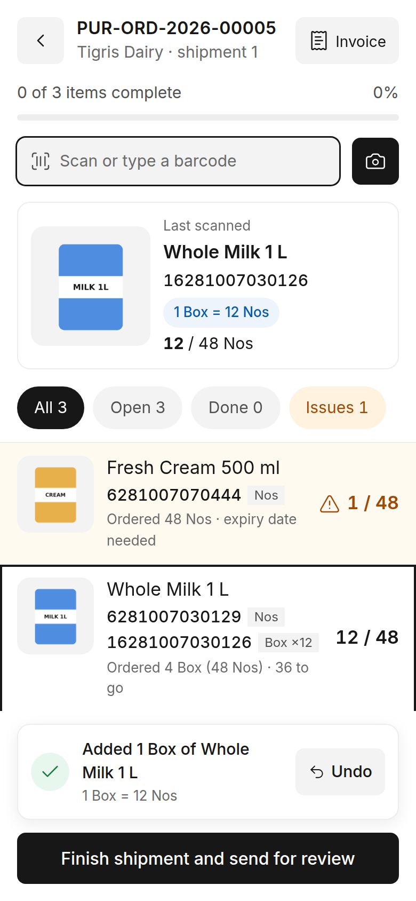
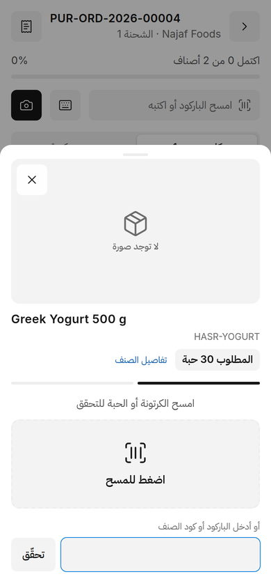
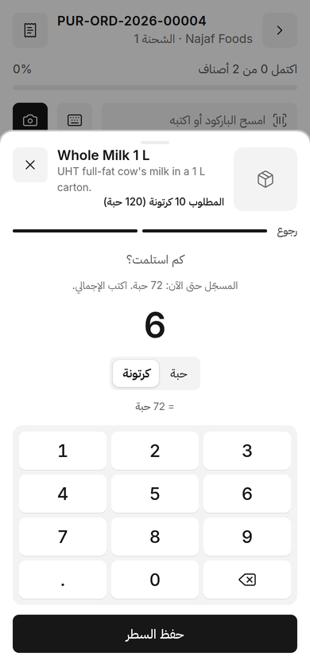
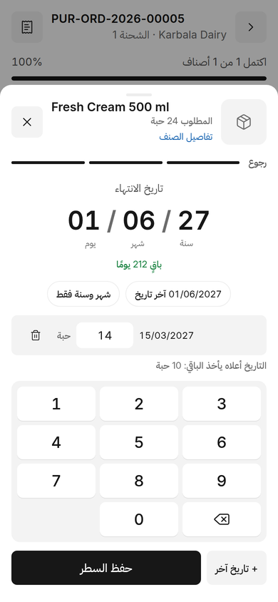
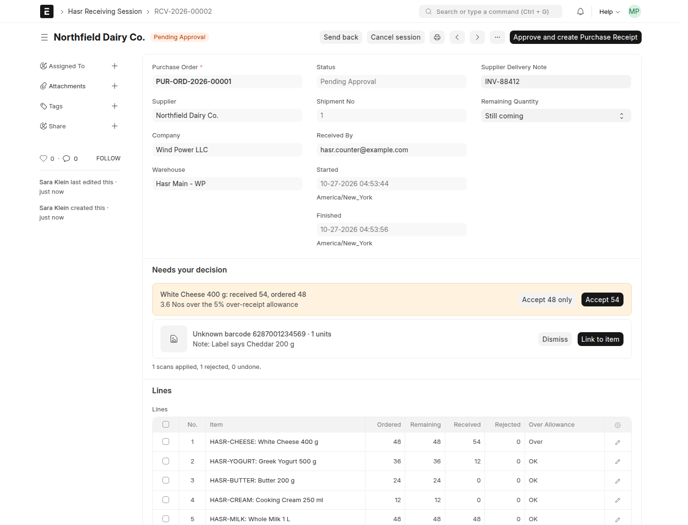
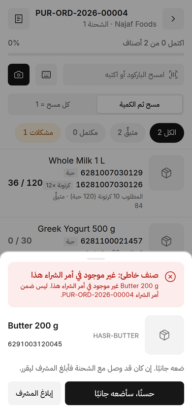
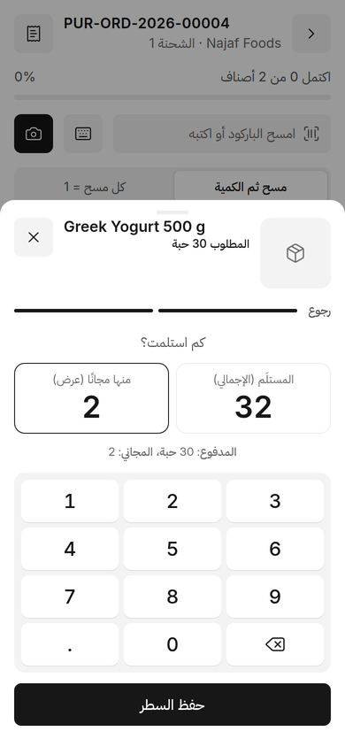

<div align="center">
  
  <h1>hasr · حَصر</h1>
  <p><b>Receive goods from a phone, on top of ERPNext.</b></p>
  <p>
    <a href="https://github.com/mohammedsafaaxp/Hasr/actions/workflows/ci.yml"></a>
    
    
  </p>
</div>

<p align="center">
  
  
  
  
</p>

## What is hasr?

In most warehouses that run ERPNext, receiving still happens on paper and is typed in later. hasr puts that
work on the phone the warehouse worker already carries.

hasr is a Frappe app installed **on the same site as ERPNext**. Workers open `https://<your-site>/hasr`, pick a
purchase order and scan what arrives. The phone only creates **drafts**; a supervisor reviews them in Desk and
approves. ERPNext stays the source of truth for items, barcodes, units, orders and stock, and hasr never changes
ERPNext's code.

> **Status:** receiving against a purchase order works, with batches, the supplier invoice and supplier offers.
> Offline mode is next; stock counts come after that.

## Features

The full guide, with screenshots: **[docs/FEATURES.md](docs/FEATURES.md)**

**On the phone (warehouse worker)**
- **Scan, then quantity.** A scan opens the item: a large photo, its description and the ordered quantity, then
  a keypad for how many arrived. The unit comes from the barcode (a case barcode opens in cases).
- **Check the item.** Opening an item by hand starts with a scan (or the item code) to confirm it is the right product.
- **Expiry dates and batches.** Six digits on the keypad (`150327` = 15/03/2027), month-and-year only, the last date
  used, several dates in one delivery. Expired goods are refused, short shelf life is flagged.
- **Wrong items are refused clearly.** An item that is not on the order says so at once. If it came with the
  shipment, the worker reports it for the supervisor.
- **Unknown barcodes and items that do not match their photo** are reported with a picture.
- **Supplier offers** (a setting): enter how many of the received units were free.
- **Supplier invoice:** the invoice number (required, a setting) and photos or a PDF of the invoice.
- **No lost scans.** Scans wait on the phone until the server confirms them, in order, even without a connection.
  Each scan carries an ID, so a retry never counts twice. Three sounds: counted, check this line, refused.

**In Desk (supervisor)**
- **Review screen:** summary, every line with its status, the invoice, and decision cards.
- **Decisions:** accept an over-receipt or return the excess; return a wrong item or **add it to the purchase order**;
  link or dismiss an unknown barcode; confirm or remove a reported mismatch; send the shipment back.
- **Approve** creates the Purchase Receipt as a draft, or submits it. Batches, the invoice files and the invoice
  number go with it, and on to the Purchase Invoice.
- **Today's Shipments:** one click approves a shipment that matches its order exactly.
- **Separation of duties:** approver roles are a setting, nobody approves what they received, and every line is
  checked against the user's warehouses.

**In ERPNext**
- Purchase Receipts keep the order's unit and link to the order; one row per batch.
- Free goods become a free row at price 0 with a Pricing Rule, so the item's cost is spread over all units.
- Rows added to an order go through ERPNext's own *Update Items*.
- English and Arabic (right-to-left) throughout; the app follows the device language.

<p align="center">
  
</p>

## Installation

You need a [Frappe bench](https://github.com/frappe/bench) with **ERPNext v15 or v16** installed.

```bash
cd ~/frappe-bench
bench get-app https://github.com/mohammedsafaaxp/Hasr
bench --site your-site.local install-app hasr
```

That's it. Installing creates the **Hasr Counter** and **Hasr Supervisor** roles, the **Hasr Settings** page and
an Item field *Storage*. `bench get-app` builds the phone app for you (Node 20+ for v15, Node 24 for v16).

On a production bench, restart afterwards:

```bash
bench restart
```

### Frappe Cloud

Add the app from this repository to your bench group, then install it on the site. Shared hosting plans that do
not allow custom apps cannot run hasr.

## Setup

1. **Items:** add barcodes under *Item → Barcodes*. For a case barcode set its unit (e.g. *Box*) and add the
   conversion under *Item → Units of Measure* (1 Box = 12 Nos). A photo and a description help workers tell
   similar products apart.
2. **Workers:** give them the **Hasr Counter** role. To limit someone to some warehouses, add ERPNext
   **User Permissions** on *Warehouse*.
3. **Supervisors:** give the **Hasr Supervisor** role and the right to create Purchase Receipts (for example
   *Stock User* or *Purchase User*). To add items to an order they also need to change Purchase Orders.
4. **Hasr Settings:** each option explains itself on the page (invoice number, short shelf life warning, supplier
   offers, approver roles, one-click approval).

## How it works

1. The worker opens **`/hasr`** on the phone and signs in with their ERPNext account.
2. They pick a purchase order (only submitted, open orders for their warehouses are listed).
3. They scan an item, check it against its photo and type how many arrived, then the expiry date if it has one.
4. **Finish shipment and send for review** moves the shipment to *Pending Approval*.
5. The supervisor opens it in **Desk → Hasr Receiving Session**, makes the decisions and clicks **Approve and
   create Purchase Receipt**. Stock moves only when that Purchase Receipt is submitted.

Camera scanning needs HTTPS (or `localhost`). Hardware scanners work anywhere.

## Development

```bash
# tests
bench --site your-site.local set-config allow_tests true
bench --site your-site.local run-tests --app hasr

# phone app
cd apps/hasr/frontend
yarn
yarn dev      # Vite dev server, proxies to your bench
yarn build    # writes hasr/public/frontend and hasr/www/hasr.html
```

Read [CONTRIBUTING.md](CONTRIBUTING.md) first. All ERPNext calls go through
[`hasr/erpnext_adapter/`](hasr/erpnext_adapter), the only place that imports `erpnext`; that is what keeps v15 and
v16 working. Translations live in [`hasr/translations/ar.csv`](hasr/translations/ar.csv).

<p align="center">
  
  
</p>

## License

[GNU General Public License v3](LICENSE). Test data and screenshots use invented names.
