<div align="center">
  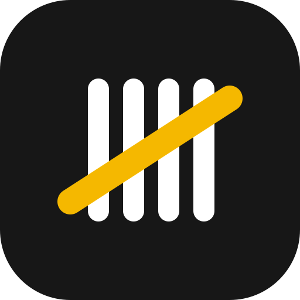
  <h1>hasr · حَصر</h1>
  <p><b>Receive goods and count stock from a phone, on top of ERPNext.</b></p>
  <p>
    <a href="https://github.com/mohammedsafaaxp/Hasr/actions/workflows/ci.yml"></a>
    
    
  </p>
</div>

<p align="center">
  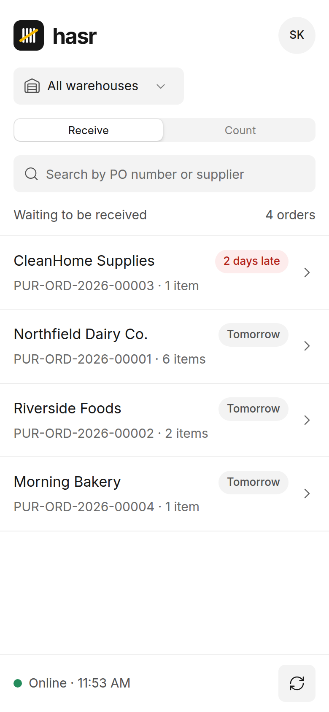
  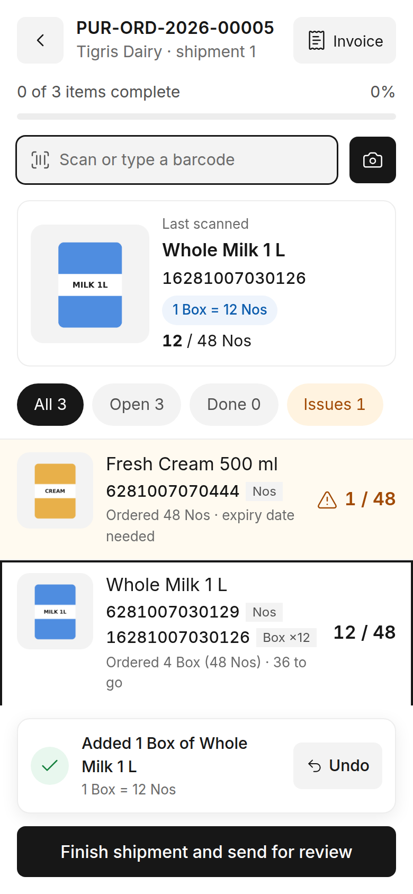
  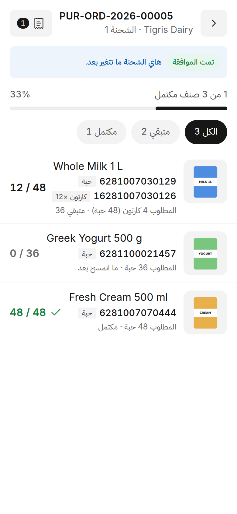
</p>

## What is hasr?

In most warehouses that run ERPNext, receiving still happens on paper and is typed into the
system later. hasr puts that work on the phone the worker already carries.

hasr is a Frappe app installed **on the same site as ERPNext**. Warehouse staff open
`https://<your-site>/hasr`, pick a purchase order and scan what arrives. hasr only ever creates
**draft** documents; a supervisor reviews them in Desk and approves. ERPNext stays the source of
truth for items, barcodes, units, orders and stock, and hasr never changes ERPNext's code.

> **Status: 0.1, online receiving against a purchase order**, plus batches with expiry dates and the
> supplier invoice (brought forward from 0.2). Offline mode comes in 0.2, stock counts in 0.3.
> See [docs/MILESTONES.md](docs/MILESTONES.md).

## Features

- **Scan to receive.** Camera scanning (works on iOS Safari) or any keyboard-wedge hardware scanner.
  Sound and vibration on every scan, with undo.
- **Three checks on every scan.** The barcode is known, the item is on the order, and the quantity
  is within ERPNext's over-receipt allowance.
- **Cases convert to units.** A case barcode adds its conversion factor in the stock unit
  (1 box = 12 units), using the item's barcode UOM.
- **Unknown barcodes** are sent to the supervisor with a photo and a note. The phone never creates items.
- **Rejected quantity** for damaged goods, posted to the rejected warehouse.
- **See what you scan.** Every line shows a large photo (tap to zoom), all its barcodes with the unit
  each one counts (unit, or box ×12), and the ordered quantity in the purchase order's unit. The last
  scanned item is shown large under the scan field, so the worker can check it is the same product.
- **Batches and expiry dates.** For batch-tracked items the worker only enters expiry dates (more than
  one if the delivery mixes dates). On approval hasr creates one ERPNext Batch per date and splits the
  Purchase Receipt row per batch. Expired dates are refused, short shelf life is flagged.
- **Supplier invoice.** Photos or a PDF of the invoice travel with the shipment; the supervisor checks the
  quantities against it, and it is attached to the Purchase Receipt on approval.
- **Safe to retry.** Every scan carries an ID from the phone, so sending it twice counts it once.
- **One open session per order**, enforced in the database.
- **Supervisor review in Desk:** accept or cap an over-receipt, link or dismiss unknown barcodes, send
  back, then *Approve and create Purchase Receipt* (draft, or submitted if you choose).
- **Item details** with zoomable photos, units, barcodes, shelf life and last receipt. Stock balances
  are never shown on the phone.
- **English and Arabic** (right-to-left) from day one; the app follows the device language.

<p align="center">
  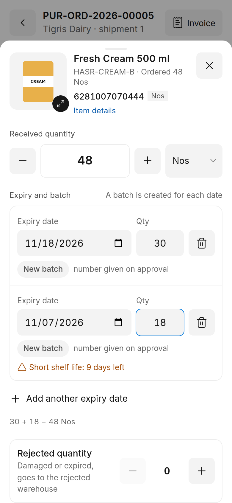
  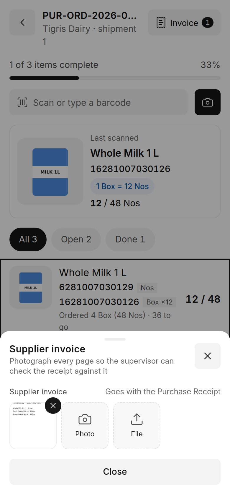
  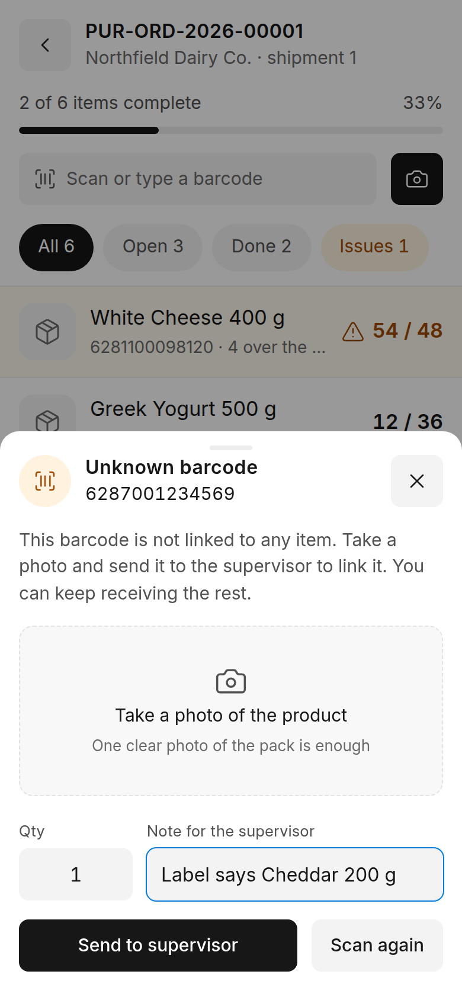
  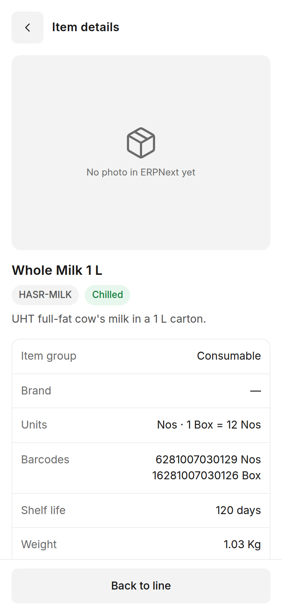
</p>

<p align="center">
  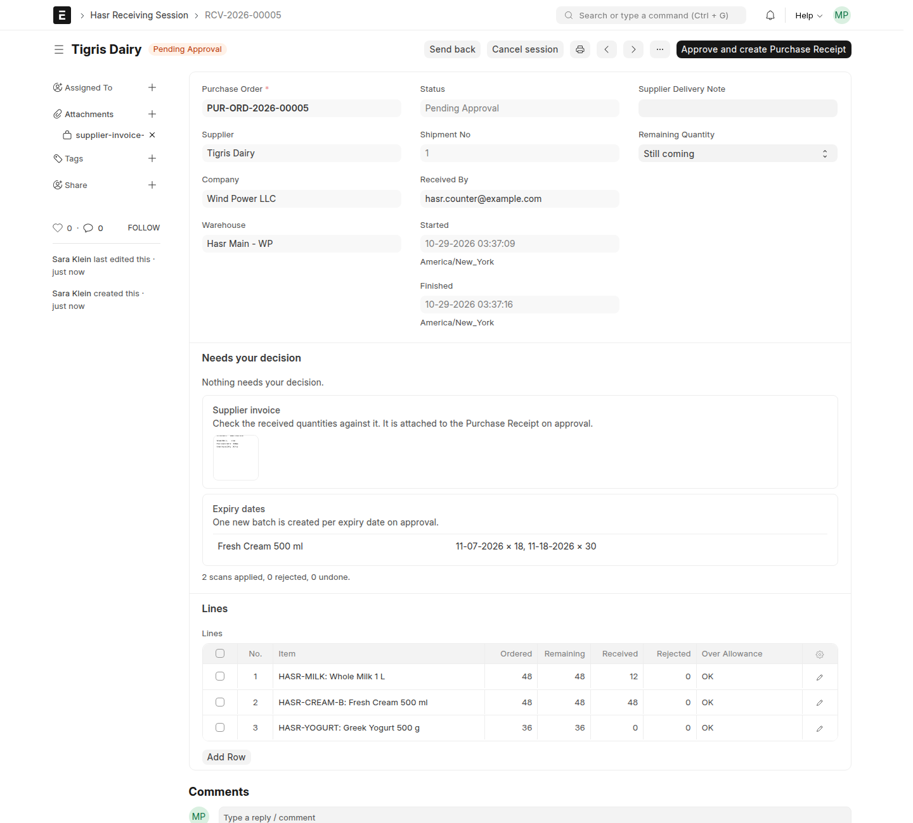
</p>

## Installation

You need a [Frappe bench](https://github.com/frappe/bench) with **ERPNext v15 or v16** installed.

```bash
cd ~/frappe-bench
bench get-app https://github.com/mohammedsafaaxp/Hasr
bench --site your-site.local install-app hasr
```

That's it. Installing creates the **Hasr Counter** and **Hasr Supervisor** roles, the
**Hasr Settings** page and an Item field *Storage*. `bench get-app` builds the phone app for you
(Node 20+ for v15, Node 24 for v16).

On a production bench, restart afterwards:

```bash
bench restart
```

### Frappe Cloud

Add the app from this repository to your bench group, then install it on the site. Shared hosting plans
that do not allow custom apps cannot run hasr.

## Setup

1. **Items:** add barcodes under *Item → Barcodes*. For a case barcode set its UOM (e.g. *Box*) and add
   the conversion under *Item → Units of Measure* (1 Box = 12 Nos).
2. **Counters:** give warehouse workers the **Hasr Counter** role. To limit someone to some warehouses,
   add ERPNext **User Permissions** on *Warehouse*.
3. **Supervisors:** give the **Hasr Supervisor** role plus the right to create Purchase Receipts
   (for example *Stock User* or *Purchase User*).
4. **Hasr Settings → Default Rejected Warehouse:** used for rejected quantity, because the Purchase
   Order line in ERPNext has no rejected warehouse.

## How it works

1. The worker opens **`/hasr`** on the phone and signs in with their ERPNext account.
2. They pick a purchase order (only submitted, open orders for their warehouses are listed) and scan.
3. They tap a line to type a quantity, change the unit or record rejected (damaged) goods.
4. **Finish shipment and send for review** moves the session to *Pending Approval*.
5. The supervisor opens it in **Desk → Hasr Receiving Session**, decides any over-receipt, handles
   unknown barcodes and clicks **Approve and create Purchase Receipt**. Stock moves only when that
   Purchase Receipt is submitted in ERPNext.

Camera scanning needs HTTPS (or `localhost`). Hardware scanners work anywhere.

## Development

```bash
# tests
bench --site your-site.local set-config allow_tests true
bench --site your-site.local run-tests --app hasr

# phone app
cd apps/hasr/frontend
yarn
yarn dev      # Vite dev server, proxies to your bench
yarn build    # writes hasr/public/frontend and hasr/www/hasr.html
```

- Read [CONTRIBUTING.md](CONTRIBUTING.md) and [docs/TECH_SPEC.md](docs/TECH_SPEC.md) first.
- All ERPNext calls go through [`hasr/erpnext_adapter/`](hasr/erpnext_adapter), the only place that
  imports `erpnext`; that is what keeps v15 and v16 working.
- Translations: [`hasr/translations/ar.csv`](hasr/translations/ar.csv). A test fails if a UI string has
  no Arabic translation or if the UI uses left/right instead of start/end.
- Open questions and verified ERPNext behaviour: [docs/QUESTIONS.md](docs/QUESTIONS.md).

## حَصر بالعربي

حَصر تطبيق مفتوح المصدر على Frappe يخلي عامل المخزن يستلم البضاعة من موبايله مباشرة على ERPNext:
يختار أمر الشراء، يمسح الباركود بالكاميرا أو بالسكانر، والكارتون يتحول لحبات تلقائياً. الموبايل يسوي
**مسودات بس**، والمشرف يراجع ويوافق من الواجهة الإدارية. الواجهة كاملة بالعربي ومن اليمين لليسار.

<p align="center">
  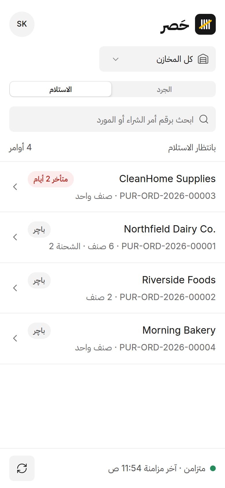
  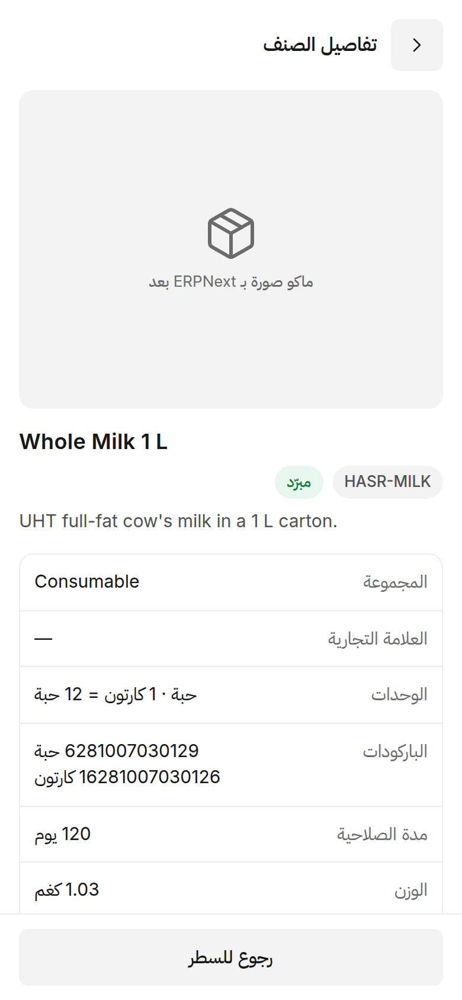
</p>

## License

[GNU General Public License v3](LICENSE). Test data and screenshots use invented names.
