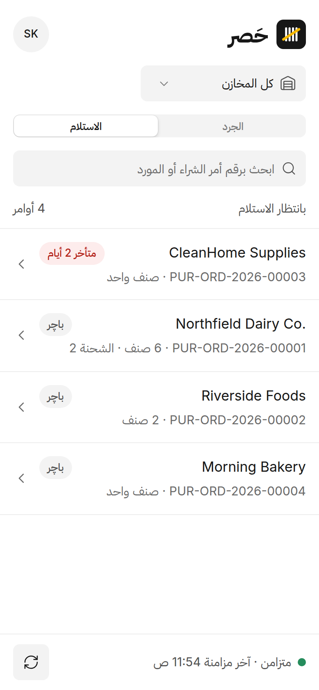
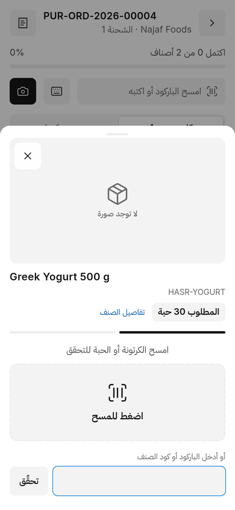
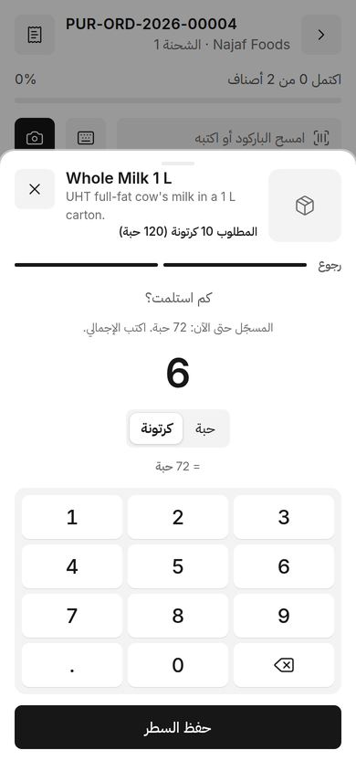
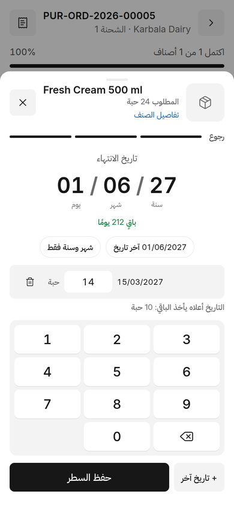
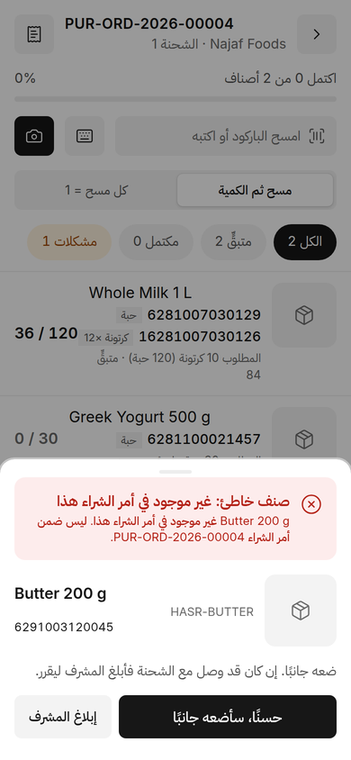
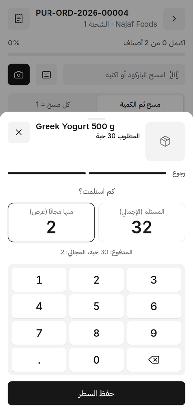

# خصائص حَصر

ما يفعله كل جزء من حَصر، لمن يستخدمه. English: [FEATURES.md](FEATURES.md)

## الاستلام من الهاتف

### اختيار أمر الشراء
تعرض الشاشة الرئيسية أوامر الشراء المعتمدة والمفتوحة لمستودعات العامل، مع المورد وعدد الأصناف المتبقية. لكل أمر
شحنة مفتوحة واحدة في كل مرة، فلا يستلم هاتفان الأمر نفسه مرتين.

### مسح ثم الكمية
الوضع الافتراضي. امسح الباركود (بالكاميرا أو بالقارئ) فيُفتح الصنف:

1. **الصنف بحجم كبير:** الصورة (تُكبَّر باللمس)، والاسم، والعلامة التجارية، والكود، والوصف، والكمية المطلوبة.
2. **كم وصل:** لوحة أرقام على الشاشة، فلا تغطيها لوحة مفاتيح الهاتف. الوحدة تُؤخذ من الباركود: باركود الكرتونة
   يفتح بالكرتونة (ويظهر 1 كرتونة = 12 حبة). ما تكتبه هو الإجمالي للسطر.
3. **تاريخ الانتهاء** لأصناف الدفعات (أدناه).

فتح الصنف يدويًا من القائمة يبدأ بـ**التحقق**: امسح الكرتونة أو الحبة، أو اكتب الباركود أو كود الصنف. المطابق
يكمل، وباركود منتج آخر يظهر بالأحمر مع زر «إبلاغ المشرف».

وضع «كل مسح = 1» هو الوضع الآخر، للعدّ كرتونة كرتونة.

 

### تاريخ الانتهاء والدفعات
لأصناف الدفعات:
- اكتب ستة أرقام كما هي على العلبة: `150327` تعني 15/03/2027. التاريخ غير الموجود (31/02) يُرفض فورًا.
- **شهر وسنة فقط** للعلب التي لا تطبع اليوم: `0327` تصبح آخر يوم من مارس 2027.
- **آخر تاريخ** يضع التاريخ المستخدم آخر مرة لهذا الصنف بلمسة واحدة.
- **+ تاريخ آخر** إذا كان في الشحنة أكثر من تاريخ: لكل تاريخ كميته، والأخير يأخذ الباقي.
- تظهر الأيام المتبقية بجانب التاريخ، وتُنبَّه الصلاحية القصيرة، ولا تُستلم البضاعة المنتهية.

عند الاعتماد يُنشئ حَصر دفعة (Batch) في ERPNext لكل تاريخ، وسطرًا في إيصال الاستلام لكل دفعة.

### الأصناف الخاطئة
مسح صنف غير موجود في هذا الأمر يُرفض مع السبب (ليس ضمن الأمر، أو استُلم بالكامل، أو لمستودع لا تستلم له). ضعه
جانبًا، أو إن كان قد وصل مع الشحنة **أبلغ عنه** مع كميته: فيرجعه المشرف للمورد أو يضيفه إلى الأمر.

الباركود الذي لا يخص أي صنف يفتح «باركود غير معروف»: التقط صورة، وأضف ملاحظة، وأرسله إلى المشرف. الهاتف لا
يُنشئ أصنافًا أبدًا.

### عروض الموردين (البضاعة المجانية)
تُفعَّل من **إعدادات حصر ← الكمية المجانية من عروض الموردين**. عندها تظهر في خطوة الكمية خانتان: المستلَم
الإجمالي و«منها مجانًا». وصول 12 منها 2 مجانًا يعني 10 مدفوعة و2 مجانًا.

### فاتورة المورد
قبل الإنهاء يكتب العامل رقم الفاتورة (إلزامي عند تفعيل الإعداد) ويمكنه إضافة صور أو ملف PDF للفاتورة. تنتقل إلى
إيصال الاستلام، ثم إلى فاتورة الشراء عند إنشائها، ويُملأ فيها رقم فاتورة المورد.

### لا يضيع أي مسح
كل مسح يُحفظ في الهاتف حتى يؤكده الخادم، ويُرسل بالترتيب حتى بعد انقطاع الاتصال أو إعادة التحميل. لكل مسح معرّف
خاص، فإرساله مرتين يُحسب مرة واحدة. ثلاثة أصوات: صفرة قصيرة (حُسب)، صفرتان (راجع هذا السطر)، طنين طويل (مرفوض).

## المراجعة في Desk

افتح **Hasr Receiving Session** للشحنة في حالة «بانتظار الاعتماد».

- **الملخص والأسطر:** المطلوب، والمستلَم، والمجاني، وتواريخ الانتهاء، وحالة كل سطر.
- **الزيادة** فوق نسبة السماح في ERPNext: «قبول الكل» أو «قبول المطلوب وإرجاع الباقي».
- **أصناف ليست في الأمر:** «إرجاع للمورد» أو **«إضافة إلى أمر الشراء»**: أدخل الكمية، والسعر (من قائمة أسعار
  المورد أو آخر سعر شراء)، وتاريخ الانتهاء لأصناف الدفعات. يُضاف سطر إلى أمر الشراء عبر «تحديث الأصناف» في
  ERPNext ويُستلم في هذه الشحنة.
- **الباركود غير المعروف:** ربطه بصنف في الأمر (فيُضاف الباركود إلى الصنف)، أو تجاهله.
- **صنف لا يطابق صورته:** قارن الصورة المتوقعة بصورة المستلَم، ثم أكّد أو احذف الكمية.
- **الإعادة** مع ملاحظة، أو **الاعتماد وإنشاء إيصال الاستلام** (مسودة أو مُرحَّل).

**شحنات اليوم** (`/app/hasr-today`) تعرض الشحنات المنتظرة اليوم. المطابقة لأمرها تمامًا تُعتمد بنقرة واحدة،
والبقية يظهر بجانبها سبب عدم المطابقة.

**فصل المهام:** من يعتمد إعدادٌ، ولا يعتمد أحد شحنة استلمها بنفسه، ويجب أن يملك المعتمِد صلاحية على كل مستودعاتها.
العامل لا يرى إلا أسطر مستودعاته.

## ما يصل إلى ERPNext

- **إيصال استلام** مرتبط بأمر الشراء، بوحدة الأمر (الكراتين الكاملة تبقى كاملة).
- **دفعات** بتواريخ انتهائها، سطر لكل دفعة.
- **البضاعة المجانية** في سطر منفصل بسعر 0 معلَّم «مجاني» ومرتبط بـ**قاعدة تسعير (Pricing Rule)** للعرض. تتوزع
  كلفة الصنف على كل الوحدات (10 مدفوعة بسعر 1,000 + 2 مجانًا = 833 للوحدة)، ولا يُحسب على الأمر إلا المدفوع.
  يُعاد استخدام العرض الفعّال إن وُجد في ERPNext، وإلا يسجّل حَصر عرضًا ليوم الاستلام فقط.
- رقم **فاتورة المورد** وملفاتها.

## الإعدادات

صفحة **إعدادات حصر** تشرح كل خيار:

| الإعداد | ماذا يفعل |
|---|---|
| تنبيه الصلاحية القصيرة (%) | ينبّه إذا بقي أقل من هذه النسبة من مدة صلاحية الصنف. 0 يوقفه. |
| رقم فاتورة المورد إلزامي | لا تُرسل الشحنة للمراجعة دون رقم الفاتورة. |
| الكمية المجانية من عروض الموردين | يُظهر «منها مجانًا» في الهاتف ويضيف أسطرًا مجانية إلى الإيصال. |
| الأدوار التي تعتمد | من يعتمد ويقرر. إن تُرك فارغًا: مشرف حصر. |
| الاعتماد بنقرة واحدة يُرحّل الإيصال | في «شحنات اليوم» تُرحّل النقرة الواحدة الإيصال أيضًا. |

## اللغات

الإنجليزية والعربية. يتبع التطبيق لغة الجهاز ويمكن تغييرها من شاشة الدخول، والعربية من اليمين إلى اليسار في كل
مكان، بما في ذلك رسائل الخادم.

