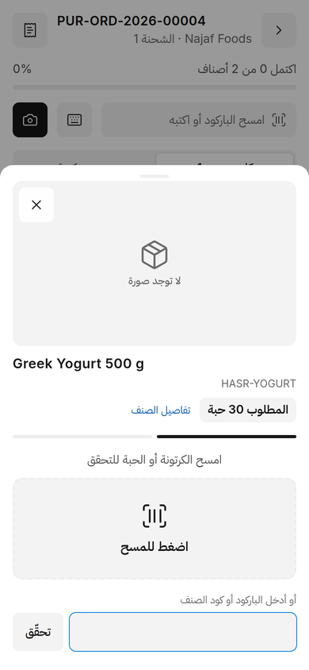
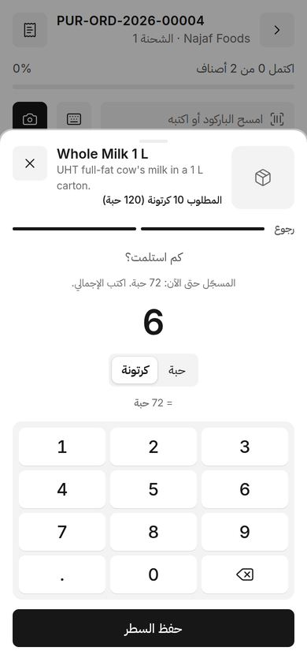
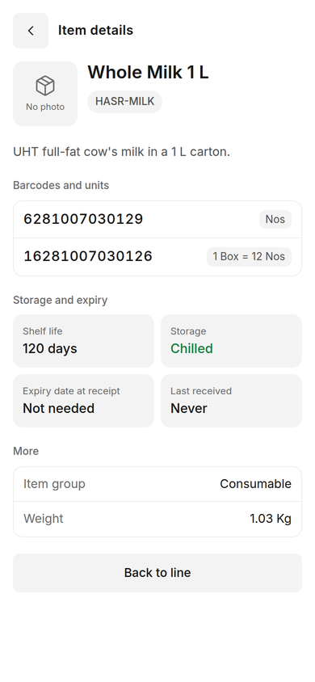
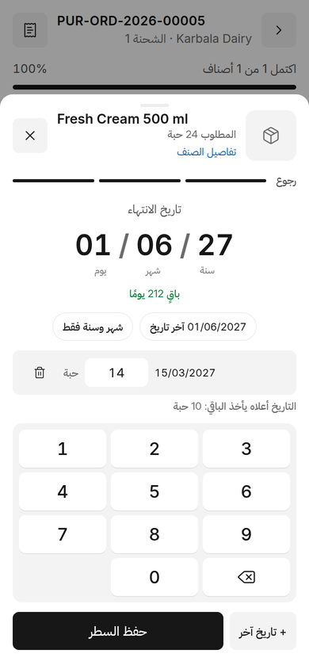
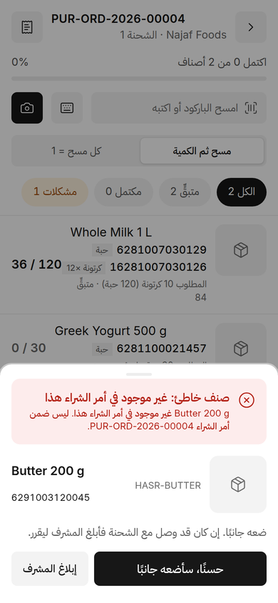
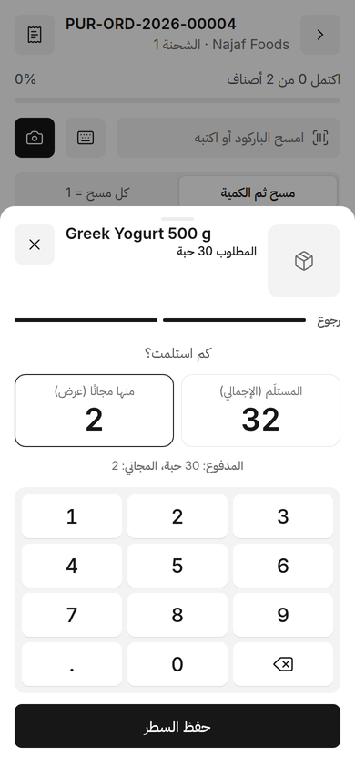
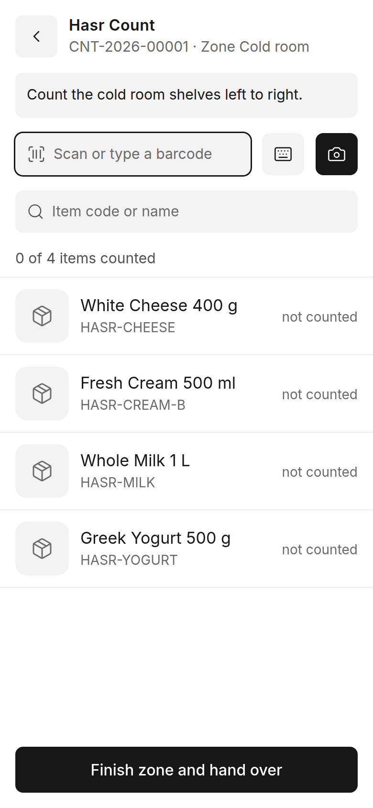
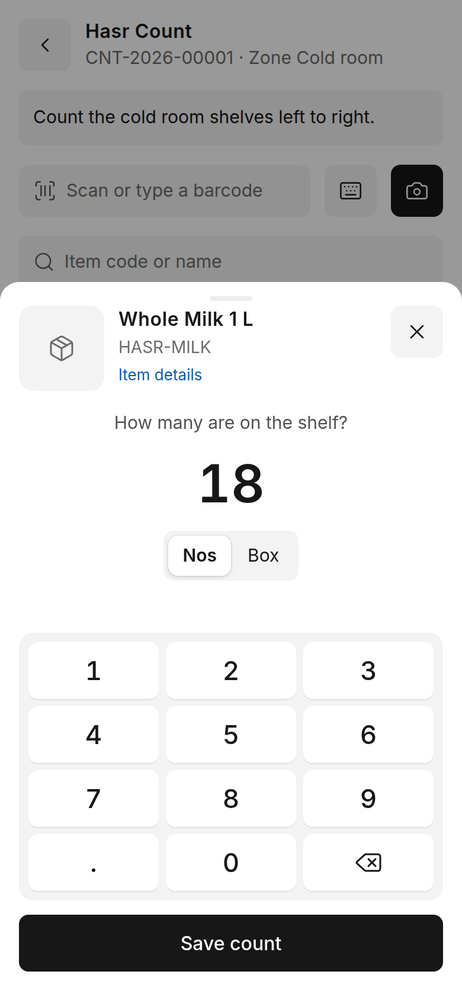
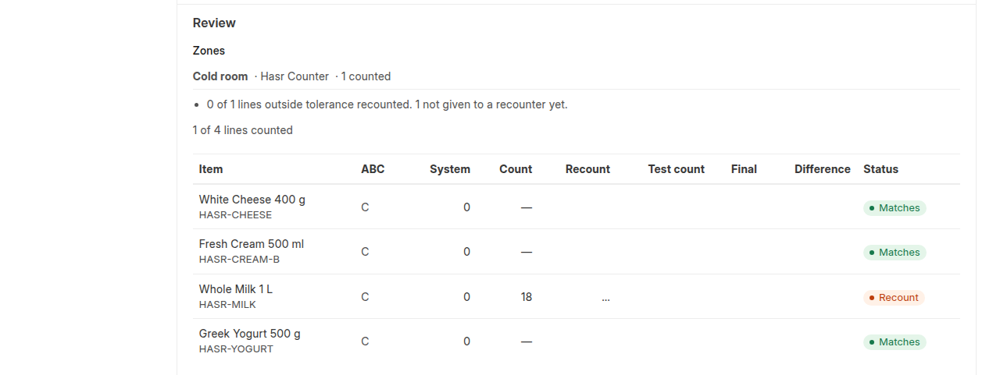
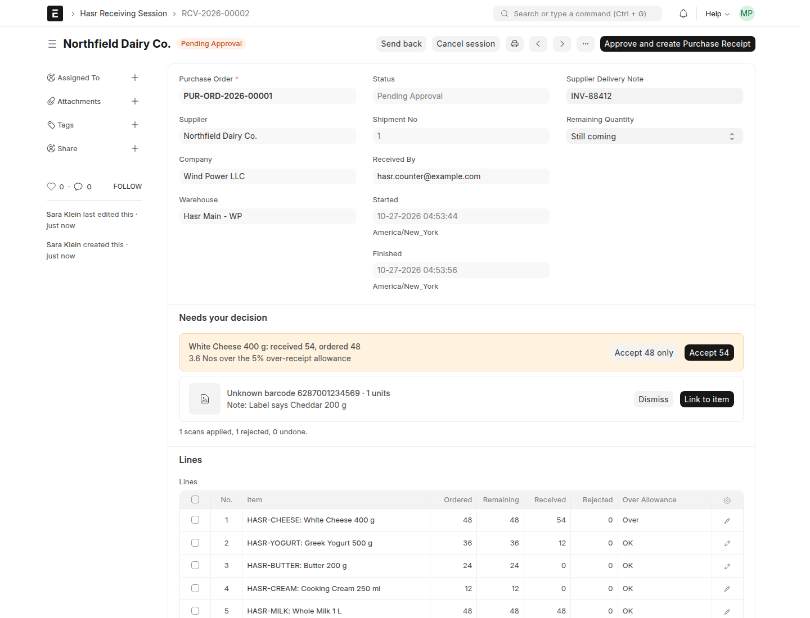

# hasr features

What each part of hasr does, for the people who use it: receiving on the phone, stock counts, and review in Desk.

## Receiving on the phone

### Add it to the home screen
Open `https://<your-site>/hasr` on the phone and choose *Add to Home Screen* (Safari) or *Install app* (Chrome).
The shortcut gets the hasr icon and opens full screen like an app. Its name follows the app language:
*hasr* in English, *حَصر* in Arabic. Installing needs HTTPS, as the camera does.

### Pick a purchase order
The home screen lists submitted, open purchase orders for the worker's warehouses, with the supplier and how
many items are left. One shipment per order is open at a time, so two phones never receive the same order twice.

Each order shows where it stands, counting shipments that are still waiting for the supervisor:

| Status | Meaning | Opens |
|---|---|---|
| a date, *Today*, *late* | nothing received yet | yes |
| *Partial 1 of 2* | some items are received or waiting for approval, others are still to come | yes |
| *In progress* | your shipment is open | yes |
| *Being received* | someone else's shipment is open | no |
| *Waiting for approval* | everything is received and waiting for the supervisor | no |

The list refreshes when you come back to it.

### Scan, then quantity
The default mode. Scan a barcode (camera or hardware scanner) and the item opens:

1. **The item, large:** photo (tap to enlarge), name, brand, code, description and the ordered quantity.
2. **How many arrived:** a keypad on the screen, so the phone keyboard never covers it. The unit comes from the
   barcode: a case barcode opens in cases (1 box = 12 pieces is shown). What you type is the total for the line.
3. **Expiry date** for batch items (below).

Opening an item from the list by hand starts with a **check**: scan the carton or the item, or type the barcode or
item code. A match goes on; a barcode of another product is shown in red with *Report to the supervisor*.

*Each scan = 1* is the other mode, for counting carton by carton.

 

### Item details
*Item details* on an item shows everything that helps tell it apart: photos (swipe, tap to zoom), name, code,
brand and description; every barcode with the unit it counts (*1 Box = 12 Nos*); shelf life, storage, whether
an expiry date is needed at receipt, and when it was last received. Stock balances are never shown on the phone.

### Expiry dates and batches
For batch-tracked items:
- Type six digits as printed on the pack: `150327` is 15/03/2027. A date that does not exist (31/02) is refused at once.
- **Month and year only** for packs that print no day: `0327` becomes the last day of March 2027.
- **Last date** fills the date used last time for this item in one tap.
- **+ Another date** when one delivery has several dates: give each date its quantity, the last one takes the rest.
- Days left are shown next to the date; short shelf life is flagged, expired goods cannot be received.

On approval hasr creates one ERPNext Batch per date and one Purchase Receipt row per batch.

### GS1 codes
Many cartons and medicines carry a long GS1 code (GS1-128 or DataMatrix) with the product's GTIN, the lot and
the expiry date. hasr reads it, as the camera or a hardware scanner sends it:
- The GTIN finds the item, whether its barcode is stored as GTIN-14, EAN-13, UPC-A or EAN-8.
- The **expiry date fills itself in** on the expiry step; a second date on the same delivery becomes a new row.
- With *Each scan = 1*, every scanned carton adds to the row of its own date. Undo takes it off that date again.
- An expired date is refused at the scan.

Turned on by default in **Hasr Settings → Read GS1 Barcodes**.

### Wrong items
A scan of an item that is not on this order is refused with the reason (not on the order, already fully received,
or for a warehouse you do not receive into). Put it aside, or, if it came with the shipment, **report it** with the
quantity: the supervisor then returns it or adds it to the order.

A barcode that belongs to no item opens *Unknown barcode*: take a photo, add a note, send it to the supervisor. The
phone never creates items.

 

### Supplier offers (free goods)
Turned on in **Hasr Settings → Free Quantity from Supplier Offers**. The quantity step then has two boxes: the
received total and *of which free*. 12 received with 2 free means 10 paid and 2 free.

### Supplier invoice
Before finishing, the worker types the invoice number (required when the setting is on) and can add photos or a
PDF of the invoice. They go to the Purchase Receipt and, when it is billed, to the Purchase Invoice, where the
supplier invoice number is filled in.

### Works without a connection
Cold rooms and back stores often have no signal. Once the app has been opened online:
- **It opens offline**, from the home-screen icon too, with the last list of orders and the shipments you had open.
- **Scans and typed quantities wait on the phone** and are sent in order when the connection is back. Each scan
  carries its own ID, so sending it twice counts it once. The header shows how many are waiting.
- Item photos and details you have seen stay on the phone.
- Starting a new shipment, sending photos and finishing a shipment need the connection; finishing waits until
  everything on the phone has been sent.

Three sounds: one short beep (counted), two beeps (check this line), a long buzz (refused). Signing out removes
the saved data from the phone.

## Stock counts

Counting follows common audit practice (ISA 501, cycle counting by ABC class): counts are blind, every difference
is recounted by someone else, and every posted difference has a reason.

### Set up a count (supervisor, in Desk)
Open **Hasr Count Session → New**:
- **Warehouse** and **Count Type**: *Full* (everything in scope at one moment) or *Cycle* (a small batch while
  work goes on).
- **Scope**: the whole warehouse, an item group, a brand, chosen items, the items *due by ABC class*, or
  *problem items* (a difference in the last 180 days, or a negative balance).
- **How counters enter counts**: *Scan* each item, or pick from a *List*.
- **Zones**: an aisle, a shelf or a cold room, with one counter each.
- **Freeze stock** (optional): sales, receipts and transfers of these items in this warehouse are refused until the
  count is approved. A freeze lifts by itself after the hours set in Hasr Settings.

**Start count** takes the balances and sends the count to the counters' phones.

### Count on the phone
The **Count** tab lists the counts you are part of. Scan an item (or pick it from the list), choose the batch for
batch items (a GS1 code picks it by itself), and type how many are on the shelf, in any of the item's units.
Typing again replaces your earlier number. Items whose unit is never split (pieces, bottles) take whole numbers
only. Counting works offline; counts are sent when the connection is back, and only under the name of the person
who counted them, also when someone else uses the phone in between.

**The phone never shows the system quantity.** When your zone is done, **Finish zone and hand over**.

 

### Review, recount and approve
- **Close counting**: zone counts add up per item and batch. Anything not counted is taken as not found.
- A line outside its **tolerance** (by ABC class) goes to **recount**. *Give recount to…* someone who did not count
  it the first time; they see only those items, blind.
- A sample of the lines that matched is **test-counted** by the supervisor (*Enter test counts*). A test count that
  differs wins, and then another approver has to approve the count.
- **Finish review**, give a **reason** for each difference (theft, damage, receiving error, picking error, unit
  of measure error, unknown, other), then **Approve**. Whoever counted cannot approve, nor can a supervisor whose
  test count changed a quantity.
- Approval creates a **Stock Reconciliation** for the differences only, batch by batch: the balance at that
  moment plus the counted difference, so sales since the count stay in the books. Submit it at once or later; a
  freeze lasts until it is submitted. hasr keeps the reconciliation's quantities and rates as counted while it
  is a draft. Cancelling a submitted reconciliation puts the count back to *Pending Approval*.
- Without a freeze, an item's balance is taken when it is counted, and again when it is recounted, so sales in
  between do not show as a loss.

### ABC classes and accuracy
- Every week each warehouse's items are classed **A, B or C** by the value used in the last 12 months (80% / 95%
  by default). The class sets the tolerance and how often an item is due for a count (*ABC Due* scope).
- **Hasr Inventory Accuracy** (report): the share of counted lines within tolerance per warehouse, ABC class or
  month, with the value of gains and losses.

## Review receipts in Desk

Open **Hasr Receiving Session** for a shipment in *Pending Approval*.

- **Summary and lines:** ordered, received, free, expiry dates and a status for every line.
- **Over-receipts** above ERPNext's allowance: *Accept all* or *Accept the ordered quantity and return the rest*.
- **Items not on the order:** *Return to supplier* or **Add to the purchase order**: enter the quantity, the rate
  (taken from the supplier's price list or the last purchase rate) and the expiry date for batch items. A row is
  added to the purchase order with ERPNext's *Update Items* and received on this shipment.
- **Unknown barcodes:** link to an item on the order (the barcode is added to the item), or dismiss.
- **Items that do not match their photo:** compare the expected and received photos, then confirm or remove the quantity.
- **Send back** with a note, or **Approve and create Purchase Receipt** (draft, or submitted).

**Today's Shipments** (`/app/hasr-today`) lists the shipments waiting today. One that matches its order exactly
is approved with one click; the others show why they do not match.

**Separation of duties:** who approves is a setting, nobody approves a shipment they received, and the approver
needs access to every warehouse on it. A worker only sees the lines of their own warehouses.

## What lands in ERPNext

- A **Purchase Receipt** linked to the purchase order, in the order's unit (whole boxes stay whole boxes).
- **Batches** with their expiry dates, one row per batch.
- **Free goods** as a separate row at price 0 marked free and linked to a **Pricing Rule** for the offer. The
  item's cost is spread over all units (10 paid at 1,000 + 2 free = 833 per unit), and only the paid quantity
  counts as received on the order. An active offer in ERPNext is reused; otherwise hasr records one for that day only.
- The **supplier invoice** number and files.

## Security

- **Only through hasr.** Shipments, exceptions and mismatch reports change only through hasr's own actions,
  which check the role, the warehouses and who received the shipment. Editing them directly in Desk or through
  `/api/resource` is refused, even for a System Manager.
- **Nobody approves their own work.** Only the worker who received a shipment changes its quantities, invoice
  and reports; a supervisor sends it back instead. So nobody can adjust a shipment and then approve it.
- **Warehouses.** Workers see their own shipments; supervisors see shipments of the warehouses they have access to.
- **Settings.** Supervisors can read Hasr Settings; only a System Manager changes them (they decide who approves).
- **Counts are blind.** The phone never receives system quantities or values; counts change only through hasr's
  actions once started, and nobody who counted approves.
- **Uploads.** Invoice files and photos are private files, limited in size, and their content must match their
  type (a renamed HTML file is refused).

## Settings

**Hasr Settings** explains each option on the page. Only a System Manager changes them:

| Setting | What it does |
|---|---|
| Short Shelf Life Warning (%) | Warn when less than this share of the item's shelf life is left. 0 turns it off. |
| Require Supplier Invoice No | The invoice number is needed before a shipment goes for review. |
| Read GS1 Barcodes | Reads the GTIN, lot and expiry date from GS1 codes and fills in the expiry date. |
| Free Quantity from Supplier Offers | Shows *of which free* on the phone and adds free rows to the receipt. |
| Roles That Can Approve | Who approves and decides. Empty: Hasr Supervisor. |
| One-Click Approval Submits the Receipt | On *Today's Shipments*, the one-click approval also submits. |
| Allow Stock Freeze | Lets a count freeze its items. |
| Maximum Freeze (Hours) | A freeze lifts by itself after this. Default 24, 0 = no limit. |
| Supervisor Test Count (%) | Share of matching lines the supervisor counts again. Default 10. |
| Class A / B share (%) | Cut-offs of the usage value for classes A and B. Default 80 / 95. |
| Tolerance A / B / C (%) | How far a count may differ from the system before it is recounted. |
| Count Class A / B / C Every (Days) | When an item is due for a count again. Default 30 / 90 / 180. |

## Languages

English and Arabic. The app follows the device language and can be switched on the sign-in screen; Arabic is
right-to-left throughout, including server messages.
