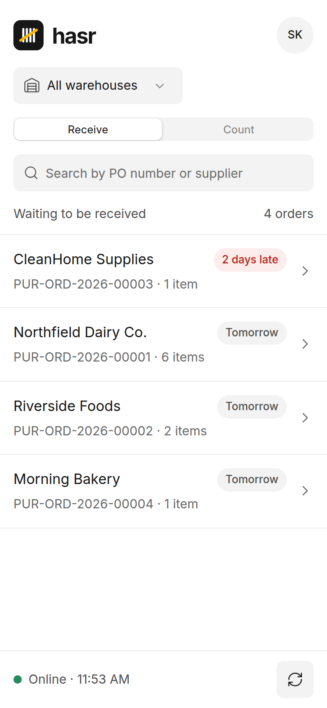
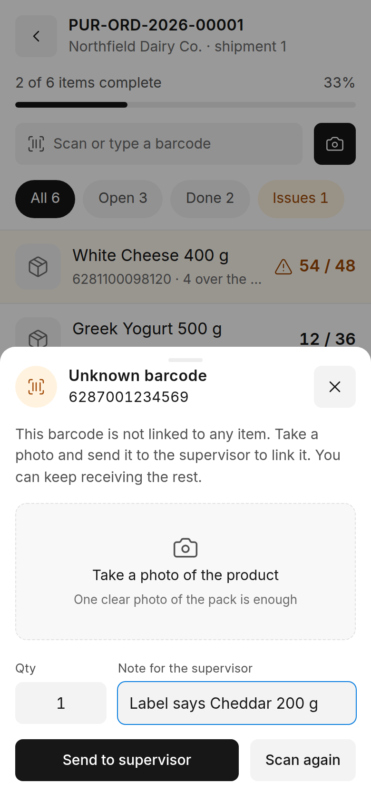
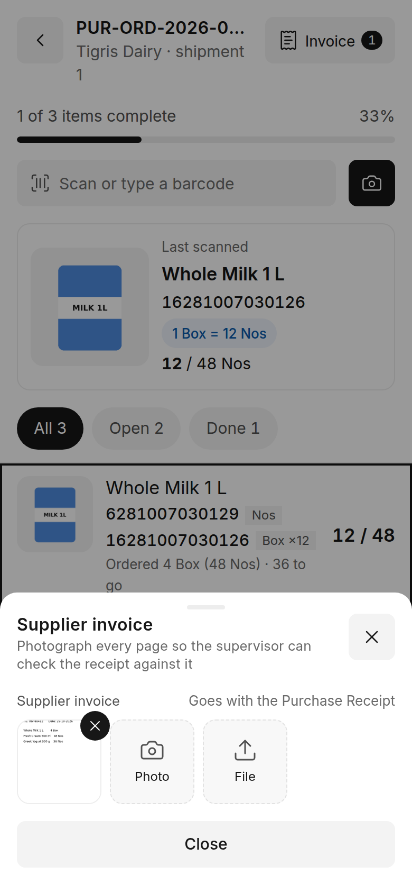

# hasr features

What each part of hasr does, for the people who use it.

## Receiving on the phone

### Pick a purchase order
The home screen lists submitted, open purchase orders for the worker's warehouses, with the supplier and how
many items are left. One shipment per order is open at a time, so two phones never receive the same order twice.

### Scan, then quantity
The default mode. Scan a barcode (camera or hardware scanner) and the item opens:

1. **The item, large:** photo (tap to enlarge), name, brand, code, description and the ordered quantity.
2. **How many arrived:** a keypad on the screen, so the phone keyboard never covers it. The unit comes from the
   barcode: a case barcode opens in cases (1 box = 12 pieces is shown). What you type is the total for the line.
3. **Expiry date** for batch items (below).

Opening an item from the list by hand starts with a **check**: scan the carton or the item, or type the barcode or
item code. A match goes on; a barcode of another product is shown in red with *Report to the supervisor*.

*Each scan = 1* is the other mode, for counting carton by carton.

 

### Expiry dates and batches
For batch-tracked items:
- Type six digits as printed on the pack: `150327` is 15/03/2027. A date that does not exist (31/02) is refused at once.
- **Month and year only** for packs that print no day: `0327` becomes the last day of March 2027.
- **Last date** fills the date used last time for this item in one tap.
- **+ Another date** when one delivery has several dates: give each date its quantity, the last one takes the rest.
- Days left are shown next to the date; short shelf life is flagged, expired goods cannot be received.

On approval hasr creates one ERPNext Batch per date and one Purchase Receipt row per batch.

### Wrong items
A scan of an item that is not on this order is refused with the reason (not on the order, already fully received,
or for a warehouse you do not receive into). Put it aside, or, if it came with the shipment, **report it** with the
quantity: the supervisor then returns it or adds it to the order.

A barcode that belongs to no item opens *Unknown barcode*: take a photo, add a note, send it to the supervisor. The
phone never creates items.

 

### Supplier offers (free goods)
Turned on in **Hasr Settings → Free Quantity from Supplier Offers**. The quantity step then has two boxes: the
received total and *of which free*. 12 received with 2 free means 10 paid and 2 free.

### Supplier invoice
Before finishing, the worker types the invoice number (required when the setting is on) and can add photos or a
PDF of the invoice. They go to the Purchase Receipt and, when it is billed, to the Purchase Invoice, where the
supplier invoice number is filled in.

### Scans are never lost
Every scan is kept on the phone until the server confirms it, and sent in order, also after a lost connection or
a reload. Each scan carries its own ID, so sending it twice counts it once. Three sounds: one short beep
(counted), two beeps (check this line), a long buzz (refused).

## Review in Desk

Open **Hasr Receiving Session** for a shipment in *Pending Approval*.

- **Summary and lines:** ordered, received, free, expiry dates and a status for every line.
- **Over-receipts** above ERPNext's allowance: *Accept all* or *Accept the ordered quantity and return the rest*.
- **Items not on the order:** *Return to supplier* or **Add to the purchase order**: enter the quantity, the rate
  (taken from the supplier's price list or the last purchase rate) and the expiry date for batch items. A row is
  added to the purchase order with ERPNext's *Update Items* and received on this shipment.
- **Unknown barcodes:** link to an item on the order (the barcode is added to the item), or dismiss.
- **Items that do not match their photo:** compare the expected and received photos, then confirm or remove the quantity.
- **Send back** with a note, or **Approve and create Purchase Receipt** (draft, or submitted).

**Today's Shipments** (`/app/hasr-today`) lists the shipments waiting today. One that matches its order exactly
is approved with one click; the others show why they do not match.

**Separation of duties:** who approves is a setting, nobody approves a shipment they received, and the approver
needs access to every warehouse on it. A worker only sees the lines of their own warehouses.

## What lands in ERPNext

- A **Purchase Receipt** linked to the purchase order, in the order's unit (whole boxes stay whole boxes).
- **Batches** with their expiry dates, one row per batch.
- **Free goods** as a separate row at price 0 marked free and linked to a **Pricing Rule** for the offer. The
  item's cost is spread over all units (10 paid at 1,000 + 2 free = 833 per unit), and only the paid quantity
  counts as received on the order. An active offer in ERPNext is reused; otherwise hasr records one for that day only.
- The **supplier invoice** number and files.

## Settings

**Hasr Settings** explains each option on the page:

| Setting | What it does |
|---|---|
| Short Shelf Life Warning (%) | Warn when less than this share of the item's shelf life is left. 0 turns it off. |
| Require Supplier Invoice No | The invoice number is needed before a shipment goes for review. |
| Free Quantity from Supplier Offers | Shows *of which free* on the phone and adds free rows to the receipt. |
| Roles That Can Approve | Who approves and decides. Empty: Hasr Supervisor. |
| One-Click Approval Submits the Receipt | On *Today's Shipments*, the one-click approval also submits. |

## Languages

English and Arabic. The app follows the device language and can be switched on the sign-in screen; Arabic is
right-to-left throughout, including server messages.
